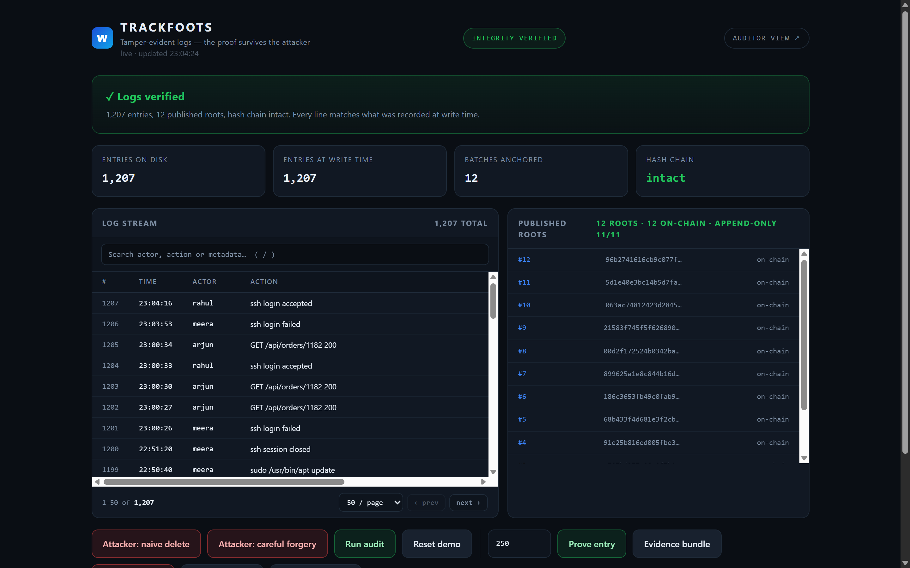

# Trackfoots

**Tamper-evident security logs — the proof survives the attacker.**

[](https://github.com/Sahil711925/Trackfoots)
[](package.json)
[](contracts/LogAnchor.sol)
[](LICENSE)

A log store whose integrity can be *proved* after a breach, even when the attacker has root on the server.
Built for **The Big Hack 2.0**, Track 02 (Cybersecurity & Blockchain), problem **B3 — "Logs the attacker can't erase."**



```bash
git clone https://github.com/Sahil711925/Trackfoots.git && cd Trackfoots
npm install
npm run start        # → http://localhost:5173  (landing)  ·  /app (dashboard)
```

No database, no cloud account, no key to obtain. It seeds itself from real log samples and anchors to a
local EVM on first run.

| | |
|---|---|
| **Dashboard** | `http://localhost:5173/app` — verified / tampered, batch-accurate |
| **Public status** | `/status` — no login, for auditors and regulators |
| **Verifier** | `/auditor` — bundle + chain only, never reads the log files |
| **Docs** | [`docs/`](docs) — architecture, threat model, demo script, judge Q&A |

> **The claim, in one line:** a root-level attacker can delete the logs and recompute every hash, so every
> local check passes. He cannot change the fingerprint published before he arrived — and that is what
> catches him.

---

## The problem

CERT-In requires Indian organisations to keep security logs for **180 days** and report specified incidents
within **6 hours**. Those logs are the only record of how a breach happened and what was taken.

They also live on the same machine the attacker now controls. With root access he deletes the incriminating
lines, and the company can prove nothing — not to a court, not to an auditor, not to the regulator.

**Hashing the logs locally does not fix this.** A capable attacker edits an entry and then recomputes every
hash downstream. The file becomes internally perfect and every local check passes. We built that attacker and
we demonstrate him.

---

## How it works

```
   write                      seal                       publish                    verify
┌───────────┐   ┌──────────────────────┐   ┌────────────────────┐   ┌──────────────────────────┐
│ log entry │──▶│ hash chain           │──▶│ Merkle root / 100  │──▶│ LogAnchor.sol (EVM)      │
│  + receipt│   │ H(prev ‖ this)       │   │ 100 leaves → 32 B  │   │ one root per batch,      │
└───────────┘   └──────────────────────┘   └────────────────────┘   │ write-once, public       │
                                                                     └──────────────────────────┘
                                                                              │
                                          ┌───────────────────────────────────┘
                                          ▼
                              ┌────────────────────────────┐
                              │ auditor: three checks      │
                              │ 1 chain  2 root  3 receipt │
                              └────────────────────────────┘
```

1. **Every entry is chained.** `hash = sha256(prevHash ‖ seq ‖ ts ‖ actor ‖ action ‖ meta)`. Change one line and
   every hash after it breaks.
2. **Every 100 entries become two fingerprints.** A **batch root** (this batch only — finds the tampered batch)
   and a **checkpoint root** (every entry so far — CT-style, and what the chain stores).
3. **The checkpoint root is published on-chain.** `LogAnchor.anchor(seq, root, org)` stores it and **refuses to
   ever overwrite that sequence number**. Not by the operator, not by the attacker.
4. **Every write also issues a receipt.** The content fingerprint goes to the auditor at write time, outside the
   server, so deleted lines can later be proven to have existed.

Verification then compares four things: the recomputed chain, the recomputed batch roots, the recomputed
checkpoint roots, and the receipts. Consistency proofs additionally link checkpoint N to checkpoint N+1, so the
log is provably **append-only across time** — not just tamper-evident within a batch.

The Merkle implementation follows **RFC 6962** (Certificate Transparency): `SHA256(0x00 ‖ leaf)` for leaves,
`SHA256(0x01 ‖ l ‖ r)` for nodes, subtrees split at the largest power of two, and `MTH({}) = SHA256()`. The
test suite recomputes every expected root from the RFC's formulas rather than from the implementation.

---

## Why the blockchain is load-bearing

Remove the chain and the design fails its own threat model: the attacker owns the server, so anything stored
only on the server can be rewritten. The chain supplies the one property a compromised server cannot manufacture —
**an independent witness that recorded the value before the attack.**

That is the test the track rule sets, and it is the reason `LogAnchor` exists rather than a database row.

---

## Quick start

```bash
npm install
node scripts/wallet.js          # creates a testnet wallet (optional)
npm run deploy                  # compile + deploy LogAnchor
npm run seed && npm run anchor  # 1,200 entries, roots published
node server.js                  # http://localhost:5173
```

On Windows, double-click **`START_DEMO.bat`** — it starts a local EVM chain, deploys the contract if missing,
starts the server and opens the browser.

---

## Repository map

| Folder / file | What it is |
|---|---|
| `contracts/LogAnchor.sol` | The entire on-chain half: one mapping, one write-once `anchor()` |
| `lib/merkle.js` | SHA-256, Merkle root, inclusion proof, proof verification |
| `lib/store.js` | Append-only log, hash chaining, receipts, batch size |
| `lib/verify.js` | The auditor: chain check, root check, receipt check, bad-batch search |
| `lib/attack.js` | Two attacker profiles — naive deletions and a careful forger |
| `lib/proof.js` | Inclusion proof for a single entry |
| `lib/bundle.js` | Printable auditor evidence bundle (single entry, A4, self-contained) |
| `lib/liveness.js` | Detects anchoring that has silently stopped |
| `lib/consistency.js` | Proves checkpoint N+1 extends checkpoint N (append-only across time) |
| `lib/receipts.js` | HMAC-signed write receipts — the attacker can't mint one |
| `lib/auditor.js` | Independent verifier: bundle + chain, no access to `data/` |
| `public/auditor.html` | The auditor's own screen — never touches the operator's logs |
| `lib/chain.js` | Contract compile, deploy, anchor, read-back |
| `lib/seed.js` | Synthetic log generator (1,200 demo entries) |
| `lib/formats.js` | Real parsers: OpenSSH `auth.log`, nginx combined, RFC 3164 syslog |
| `lib/retention.js` | CERT-In 180-day policy: what is in scope, what has expired, what must not be pruned |
| `samples/` | 157 lines of authentic-format log files used by the importer and its tests |
| `lib/env.js` | Config loader — `.env` always wins over inherited shell values |
| `server.js` | Web server + JSON API (`/api/state`, `/api/verify`, `/api/attack`, `/api/proof`, `/api/bundle`) |
| `public/index.html` | The demo UI — one file, no build step |
| `cli.js` | Terminal auditor (`node cli.js verify`) |
| `scripts/` | Entry points: seed, anchor, attack, deploy, wallet, prove, bundle, chain verification |
| `tests/` | 178 automated tests (`npm test`), CI on every push |
| `docs/` | Architecture, demo script, judge Q&A, **prior art**, build checklist |
| `LICENSE` | MIT |
| `START_DEMO.bat` / `VERIFY_CHAIN.bat` | One-click launch and one-click chain proof |

---

## Prove it yourself

```bash
node scripts/attack.js smart 3    # attacker deletes 34 entries and rebuilds every hash
node cli.js verify                # -> TAMPERED, batch 3 named, 34 entries recovered
node scripts/verify-chain.js      # -> re-reads roots from the chain: 12 match, 0 differ
node scripts/prove.js 250         # -> inclusion proof: entry 250 was inside the published batch
node scripts/export-bundle.js 250 # -> exports/bundle-250.html, the auditor artifact
npm test                          # -> 61 passing
npm run liveness                  # -> HEALTHY / STALE, detects anchoring that stopped
npm run consistency               # -> APPEND-ONLY: 11/11 checkpoint pairs extend
npm run bundle -- 250             # -> exports/bundle-250.html + .json (the exhibit)
npm run auditor -- exports/bundle-250.json   # -> verifies from the chain alone
```

### Verify without trusting us

The auditor is a separate verifier. It reads **two things**: the bundle and the root published on-chain.

```bash
npm run bundle -- 250
npm run auditor -- exports/bundle-250.json
```

```
✔ entry digest
✔ inclusion proof rebuilds the checkpoint root
✔ checkpoint root matches the chain
VERDICT: the bundle is genuine
```

Edit the bundle by one character and the same command fails — the digest and the proof both stop
matching, while the chain root is unchanged. You can also open `/auditor` in the web UI and paste a
bundle, or press **Tamper with it** to watch the verification break.

Receipts are signed with HMAC-SHA256 using a key held **outside** `data/` (environment/KMS). An intruder
with root can read every log file and still cannot forge a receipt for a line that was never written.

That proves each receipt is real. It does not prove you were handed *all* of them — an attacker who owns
the receipt store could quietly drop one. So the receipt set is committed to its own Merkle root, and
exported bundles carry that root next to the receipts:

```bash
npm run verify:receipts -- --bundle exports/bundle-250.json
```

```
  ✔ every receipt signature is valid            1200 valid (key: env)
  ✔ receipt set reproduces the committed receipt root
  ✔ receipt inclusion proof rebuilds the receipt root
  VERDICT: the receipt set is complete and authentic          exit 0
```

Drop one receipt from the same file and every surviving signature is still valid — but the set no longer
reproduces the committed root: `receipt set is incomplete: 1199 present, 1200 committed`, exit 2.
Authenticity and completeness are different claims, and the verifier now makes both.

---

## Filing it: the 6-hour report

CERT-In's directions require notification within six hours. `npm run incident` turns verifier output into that
page — incident id, detection time, affected sequences, published roots, contract address, and explicit
verification steps for the recipient:

```
incident  TF-20261120-1601-012
verdict   TAMPERED
missing   34 · rewritten 7 · affected batches 10
written   exports/incident-TF-20261120-1601-012.html
```

The page is generated by the same code that verifies the log, so it cannot claim more than the evidence shows.
Run it on a clean log and it says *"No integrity failure detected"* rather than manufacturing an incident.

There is a section a nicer-than-necessary report would omit:

> **Cannot prove** — the *content* of deleted entries. A one-way hash proves existence, not text.
> **Cannot prove** — who performed the deletion. That needs host-level forensics outside this system.

`/incident` serves the same page live, and the UI has an **Incident report ↗** button.

---

## Somebody gets told

Detection without notification is a log line, not a control. A tamper event writes an alert record and,
if `ALERT_WEBHOOK` is set, POSTs it to Slack/PagerDuty/anything that accepts JSON:

```
ALERT  tamper-detected · 34 entries deleted and 7 rewritten in batch 3 · raised 21:25:57 · dispatched
```

It appears under the banner in the UI, so the presenter can show the moment the system notices — and the
one-per-minute guard means a polling page cannot turn one incident into a hundred pages.

```
GET /api/alerts   →  { alerts: [...], webhook: false }
```

Honest scope: fire-and-forget POST, no retries, no queue. If the network is down the alert is in the local
log and nowhere else. That is the right trade for a 24-hour build and the wrong one for production.

---

## Writing logs to it (the part that makes it a product)

An application posts a line and gets back a **signed receipt** — proof of what it wrote, at the moment
it wrote it, before any attacker can touch the server.

```bash
curl -s -X POST localhost:5173/api/log \
  -H "x-api-key: $INGEST_KEY" -H 'content-type: application/json' \
  -d '{"actor":"rahul","action":"ssh login accepted","meta":{"ip":"103.21.44.9"}}'
```

```json
{ "accepted": 1, "rejected": [],
  "receipts": [{ "seq": 1201, "chash": "1a8b5856…", "sig": "155f5fb7…", "sigAlg": "hmac-sha256" }] }
```

| Rule | Value |
|---|---|
| Endpoint | `POST /api/log` (alias `/api/ingest`) |
| Auth | `x-api-key` header, key from `INGEST_KEY`; 401 without it |
| Batch | up to 1,000 entries per request |
| Body limit | 2 MB |
| Validation | `action` required; `ts` must parse; `meta` must be an object under 4,000 bytes |
| Response | `202` with one receipt per accepted line; `400` with per-index reasons |
| Stats | `GET /api/stats` — entries, batches, **unanchored** backlog |

`GET /api/stats` also reports `unanchored`: entries written since the last published batch. That number is
the anchor window, exposed rather than hidden — in the UI it is the one line that can grow between attacks.

There is a **`Send a live line`** button in the UI that pushes a real line through this path so the receipt
can be shown on screen. It is restricted to localhost; the authenticated endpoint is the real one.

---

## Adopting it

Three ways in, none of which require changing an application.

**1 · Shipper** — a server that already writes logs keeps writing them; the shipper tails the file and
pushes it through the API:

```bash
npm run shipper -- --file /var/log/auth.log --url http://localhost:5173 --key $INGEST_KEY --follow
```

```
  format    sshd (auto-detected)
  offset    0 (fresh start)
  endpoint  http://localhost:5173/api/log
  batch     50 per POST, follow on
sent 50 entries -> 202 accepted 50; receipts 50, first seq 1
```

It resumes from a stored byte offset, restarts from zero on log rotation, retries with backoff, and only
commits the offset after the API accepted the batch — a failed POST is re-sent, never skipped.

**2 · Multi-tenant** — one deployment, several companies, isolated by process rather than by row:

```bash
npm run tenants -- up        # acme :5174, fintech :5175, own data dir, own key, own roots
npm run tenants -- status    # entries/batches per tenant
npm run tenants -- down
```

```
  tenant   port  state  entries  batches  unanchored
  acme     5174  up     121      2
  fintech  5175  up     121      2
    distinct data dirs: yes
```

Separate processes, separate `data/` trees, separate ledgers and separate ingest keys — one tenant's
compromise cannot touch another's evidence. A shared-rows design would have been cheaper and weaker.

**3 · Public status page** — `/status`, no login, no operator UI:

> `VERIFIED · 1,200 entries covering 12 published batches · hash chain intact · 11/11 append-only proofs`

with the latest root, every published batch, the contract address, and an entry-coverage lookup. If the API
is down it says **UNREACHABLE** — a status page that lies about reachability is worse than none.

---

## Searching the log

The dashboard is a working log browser, not a screenshot: free-text search across actor, action and
metadata, click any actor to filter, and pagination over all 1,200 lines.

```
search "ssh login failed"   →  1–50 of 146
+ actor deploy              →  1–9 of 9
```

`/` focuses the search box, `Esc` clears it, and a refresh never wipes your filter or page.

---

## Quai Network

The hackathon's chain, supported natively:

```bash
npm run quai:check      # compile with 0.8.20, derive a Quai address, price the deploy — spends nothing
npm run quai:faucet -- <dropId>   # claim testnet QUAI (x402 proof-of-work payment, no account)
npm run quai:deploy     # deploy to Orchard (chain 15000), then --anchor 1 to publish a checkpoint
```

Three Quai-specific things this handles that a naive port does not: the **9-bit routing prefix** in
addresses (an Ethereum address is rejected as a Qi address), the **`quais` SDK** (ethers cannot sign
Quai's Protobuf transactions), and the **compiler ceiling** of Solidity 0.8.20.

Current status: verified against the live Orchard chain — chainId 15000, block 1,878,006, deployment
priced at 333,698 gas — blocked only on testnet funds. Full detail in [`docs/QUAI.md`](docs/QUAI.md).

---

## Real logs, not invented ones

The demo seeds synthetic entries so the numbers are reproducible, but the importer takes actual logs:

```bash
npm run import -- samples/auth.log        # OpenSSH auth.log
npm run import -- samples/access.log      # nginx combined
npm run import -- samples/syslog.log      # RFC 3164 syslog
```

```
detected format : sshd
lines read      : 56
parsed          : 52
skipped         : 4
written         : 52 entries
```

Truncated writes, `-- MARK --` rotation markers and binary noise are skipped rather than mangled into
entries — a parser that silently invents a log line is worse than one that refuses.

## Performance

Measured on a laptop (i5-1135G7, 7.8 GB RAM, Node 26), median of repeated runs — see
[`docs/PERFORMANCE.md`](docs/PERFORMANCE.md) for the method and caveats.

| Metric | Result |
|---|---|
| Ingest | **88,700 entries/s** (11.3 µs/entry, 386 B/entry) |
| Hash-chain re-verify | **4.1 µs/entry** (50k entries in 204 ms) |
| Merkle root, 100 leaves | **0.58 ms** (5.8 µs/leaf) |
| Merkle root, 10,000 leaves | 39 ms (3.9 µs/leaf) |
| **Full audit, 50,000 entries / 500 checkpoints** | **2.2 s** (44 µs/entry) — was **107 s** before the accumulator rewrite |
| **Checkpoint re-derivation, 50,000** | **438 ms vs 107,506 ms** — 245× faster, roots byte-identical |
| Anchor gas | ~73,905 gas (static estimate from the contract) |
| Anchoring cost | **$2.30 per 100K events** at 100-event epochs — matches arXiv 2609.01931, as expected since gas sets the price, not our code |

The audit is **O(n log n)**: checkpoint roots come from a single incremental RFC 6962 accumulator
(`createMerkleAccumulator`) instead of rebuilding each prefix from scratch. The rewrite was accepted only
because it reproduced every published root byte-for-byte — 600 prefix sizes, 27 tree-shape boundaries, and
all 12 checkpoints of the live demo agree, and `tests/merkle-incremental.test.js` pins it.

Honest caveats: single-threaded, laptop CPU, no `fsync` (durability covers a process crash, not power loss).

Expected output of the middle step, which is the whole point:

```
✗ LOG INTEGRITY: TAMPERED
  entries on disk      1166
  entries at write time 1200
  hash chain            intact          ← the file is internally consistent
  root check            binary-search
  MISMATCH AGAINST PUBLISHED ROOTS
   batch 3  entries 201-300
  DELETED ENTRIES RECOVERED FROM AUDITOR RECEIPTS  34
```

The chain says **intact** and the verdict says **TAMPERED**. Both are true — he rebuilt every hash, and the
published root still disagrees.

---

## Honest limitations

- **Anchor window.** Entries written since the last batch was published are protected by the hash chain only.
  Closing it needs immediate anchoring (more gas) or per-write receipts promoted to the primary path.
- **Anchoring liveness.** An attacker who blocks outbound traffic stops new anchors. History cannot be rewritten,
  but new entries go unwitnessed. `npm run liveness` detects this (unanchored backlog, anchor age, sequence gaps)
  and exits non-zero; it is not yet wired to paging or email.
- **Signing key.** If the anchor key is stolen, the attacker can publish *new* roots. He can never alter old ones.
- **Receipts.** In this build they live in a separate directory on the same machine — a trust-domain simulation,
  not real isolation.
- **Chain.** The demo runs against a local EVM chain; the same contract compiles and deploys to Polygon Amoy
  unchanged (`CHAIN=amoy`). No public-chain deployment is presented as done.
- **Data.** All 1,200 log entries are synthetic. No personal data is written to the chain — only Merkle roots.

## Prior art

Merkle logging is established: Certificate Transparency (RFC 6962), Trillian, Sigstore Rekor, immudb. Trackfoots
is not a new primitive. The contribution is the **incident-evidence workflow** for CERT-In-style obligations —
a write-once anchor, a three-way auditor, a single-entry inclusion proof and a court-ready bundle — together with
a demonstration that a careful forger defeats local hashing and does not defeat this.

---

*Track 02 · B3 · The Big Hack 2.0 · Acharya Institute of Technology, Bengaluru*
